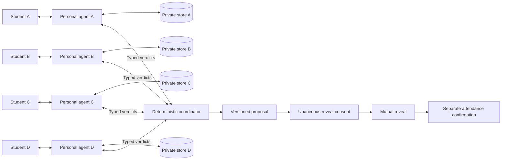

# down?

**less “we should.” more “we did.”**

Find the plans hiding in your friend group. The proposed distinction from same-activity matching is **group-dependent conditions plus unanimous, version-specific disclosure consent**. This is a product hypothesis; competitive uniqueness and real-world demand have not been established.

## Run locally

Use Node.js 22 or newer and npm. No database or API key is required for the complete seed demo.

```sh
npm install
npm run dev
```

Open http://localhost:3000. Four synthetic students and three events are seeded automatically. The development launcher uses polling to work on systems with restricted file watchers.

```sh
npm test
npm run typecheck
npm run build
npm start
```

Run development and production servers separately. This MVP uses one in-memory server process; restarting it resets the demo. It is not a serverless or multi-instance deployment.

## Demo

1. Click **run scripted demo**. The script types each private request, reviews conditions, approves discovery, and runs real coordinator evaluations.
2. Watch the protocol inspector: the two-person attempt fails `GROUP_TOO_SMALL`; the Sunday-only participant rejects Saturday with `WRONG_DAY`.
3. A three-person proposal asks for reveal consent without exposing names. Each approval passes through the same versioned command handler used by the buttons.
4. After all three approvals, Alex, Maya, and Jay see **“wait, you too?”**. Dev remains outside the proposal.
5. The script stops before attendance. Click **Alex withdraws** to demonstrate the adversarial case: version 2, two remaining people, cleared approvals, and Jay's explicit “still down, or pass?” question.
6. Choose **still down** in Jay's phone to approve lowering his minimum to two. This creates another version and requires fresh reveal and attendance decisions. Or choose **pass** to close the proposal.
7. For a successful attendance ending, reset, rerun, and select **I'm in** on all three phones instead of withdrawing. Only then is the plan confirmed.

The UI also works manually. Click each example request or enter a message, edit the conditions, and approve discovery. Matching runs after all four students have active discovery permissions; **find a crew** can explicitly evaluate the currently approved students earlier. Early matching may produce a different group, because the algorithm uses only current permissions and conditions.

Reset cancels an active script and clears all synthetic state. It does not represent a real person's consent: automatic approvals are a clearly labeled demo convenience only.

### Multi-device demo

Each student has a separate view:

- `/student/alex`
- `/student/maya`
- `/student/jay`
- `/student/dev`

On devices on the same trusted local network, replace `localhost` with the host computer's LAN address. Use synthetic data: anyone who can reach a student route can act as that student. There is no production authentication.

## Architecture



- **Next.js App Router + TypeScript + CSS:** responsive four-phone operator demo and standalone student pages. CSS is used directly instead of adding a utility framework.
- **Bound agent stores:** each personal agent receives a capability with `read()`, `readStudent()`, and `update()` for only its owner. No caller-supplied student ID is accepted by its read method. Returned snapshots are defensive copies.
- **Deterministic constraints:** activity, weekday, budget, end time, group size, beginner suitability, and approved-friend presence. An end-before condition is strict; budget is an inclusive maximum. Demo times share one campus-local clock.
- **Coordinator:** enumerates candidate subsets largest first and asks each agent to evaluate the event and proposed membership. It receives verdicts, not messages, private conditions, or friend lists. With four participants, exhaustive enumeration is small and inspectable.
- **State machine:** all decisions specify proposal ID and version. Membership or event changes clear reveal and attendance approvals. A single synchronous transition authorizes reveal only after unanimous approval. Network delivery can differ across devices; simultaneous screen rendering is not guaranteed.
- **SSE:** owner-specific snapshots and a separate sanitized operator protocol endpoint. The operator panel uses short polling to leave browser HTTP/1 connections available for commands; the dedicated protocol SSE endpoint is also available. Disconnecting removes listeners and heartbeat timers.
- **Language service:** interprets one student's request and phrases a short review response. It does not select groups or grant permissions. Structured output is validated with Zod; invalid, ambiguous, failed, or refused output falls back to exact seed handling or clarification.

The server is a trusted orchestration boundary and can route owner-specific data. The agent interface itself cannot inspect another student's store. This demonstrates separate representation; it is not a claim that matching requires multiple language models.

## Permissions and privacy

1. **Discovery:** reviewed conditions may be used inside the campus friends circle for 24 hours, with server validation limiting approval to at most seven days.
2. **Reveal:** disclose your name and activity to the proposed group only if everyone approves the current version.
3. **Attendance:** separately confirm that you are actually going.

Raw messages, explanations, and friend lists are absent from coordinator protocol payloads. Agents receive member IDs to evaluate the approved-friend condition locally. Before reveal, student serializers return event details and group size, not other identities or verdict reasons.

Agent states are **logically isolated on our server**, not cryptographically isolated. The synthetic operator demo deliberately shows four private phone panes and sanitized diagnostic reason codes; it is not a student-facing privacy boundary. Standalone student pages never receive that diagnostic stream. Agent aliases are pseudonyms, not strong anonymization.

In small circles, people may infer who is interested. After a reveal, withdrawal may reveal who left by inference, and earlier disclosures cannot be undone. A pass or expiry closes the proposal and suppresses immediate same-event subsets for 24 hours to avoid disclosing a decline by shrinking the group. Discovery and proposal expiry are checked on commands and snapshots; the live stream refreshes expiry state every two seconds.

There is no authentication, encryption-at-rest layer, durable storage, booking, payment, calendar connection, stranger matching, or public feed. Do not treat the demonstration server as a production service or enter sensitive real information.

## Optional language API

Copy `.env.example` to `.env.local` and set `ANTHROPIC_API_KEY`. Keep the file local; it is excluded from version control. `ANTHROPIC_MODEL` selects the model and defaults to `claude-sonnet-4-6`.

When enabled, that student's request and structured context are sent to Anthropic for interpretation. This is separate from agent-to-agent sharing. No other student's data is included in that request. API calls time out and fall back without logging request text or credentials.

Implementation reference: [Anthropic structured outputs](https://platform.claude.com/docs/en/build-with-claude/structured-outputs).

With no key, the four exact sample requests work through deterministic parses. Maya and Jay's sample requests have an explicit **“For beginner dance”** context, shown in their own phone, rather than silently inferring an activity. Unknown free text asks for clarification; the condition editor always remains available.

## Source map

| Location     | Responsibility                                                                 |
| ------------ | ------------------------------------------------------------------------------ |
| `src/domain` | Types, Zod schemas, constraints, proposal state machine                        |
| `src/agents` | Personal agent capabilities, language adapter, exact seed fallback             |
| `src/server` | Bound stores, coordinator, serializers, protocol log, streams, HTTP errors     |
| `src/demo`   | Synthetic students, events, and cancellable script                             |
| `app/api`    | Student commands and separate SSE routes                                       |
| `components` | Phones, condition editing, protocol inspector, demo controls                   |
| `tests`      | Constraint, consent, isolation, expiry, language, and end-to-end script checks |

## Validation

Vitest covers each constraint, friend membership, the failed pair and successful trio, anonymous reveal requests, unanimity, independent attendance, stale versions, cooldowns, withdrawal, explicit condition adjustment, isolated store access, expired discovery, the three-interest cap, language failures, script cancellation, and privacy-filtered student views.

The live language API requires a user-supplied key; tests exercise its request contract and failure behavior with mocked responses. The seed demo does not depend on live API availability.

## Verification record

- 27 automated tests pass, with TypeScript validation and a successful production build.
- Browser-checked: scripted trio reveal, exclusion of the Sunday-only participant, withdrawal, unchanged minimum until explicit adjustment, fresh two-person reveal, and independent attendance confirmation.
- Checked the standalone student page at a 390 px viewport and the responsive demo layout.
- Checked project source, README, package properties, and Git author/commit messages for unintended authorship attribution. Dependency packages and compiler output are not included in the source archive.
