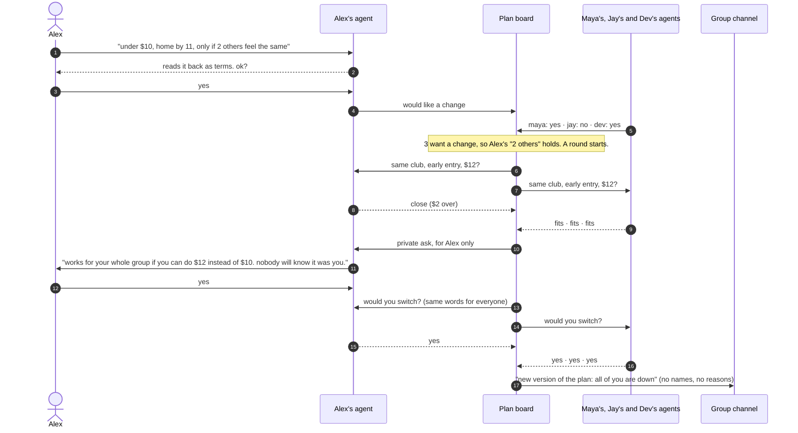

# down?

**The version of the plan everyone's actually down for.**

Everyone said "sounds fun lol" to the $40 club night. One friend can't afford it, one has an early shift, and nobody wants to be the one who says so. With down?, each student tells their own agent how they really feel. The agents negotiate versions of the plan against everyone's private terms and privately ask anyone who'd need to stretch a little. The group gets the version everyone said yes to, and nobody learns who asked for the change.

DevHacks S3 · Cubbie Hackathon · Track 02 (agent-to-agent coordination) · Team Southside: Charith Kutikuppala & Richitha Rekula

## How it works


1. **Say it privately.** In a Discord DM, a student tells their agent things like "$40 + an uber is a lot. under $10, home by 11, only if 2 others feel the same." The agent reads it into terms: whether they'd like a change, a budget, a curfew, things they rule out, and a threshold. The terms are read back, and nothing counts until the student says yes.
2. **The agents try versions.** A round starts only when at least two people want a change and every one of their thresholds holds, so a change can never point to one person. For each version of the plan, each agent answers one word: fits, close (a small stretch would work) or no.
3. **Private asks.** If a version is close for someone, only that person is asked: "works for your whole group if you can do $12 instead of $10. ok? nobody will know it was you." A no keeps the limit firm, and the agents try the next version.
4. **Everyone says yes, privately.** Everyone in the version gets the same question, so the person who's happy with the plan hears exactly what the person who can't afford it hears. A pass sends the agents to the next version.
5. **The group hears it.** The group channel gets the new version with no names, counts or reasons. If no version fits everyone, the agents offer the one that fits the most people who wanted a change, and the original plan still stands for everyone else.

### One round, step by step



If Alex says no to the ask, the limit stays firm and the agents try the next version. Most of the group gets open mic, and the club night still stands for Jay.

| Track 2 ask | In down? |
|---|---|
| Personal agents for different students | Each person DMs the bot and talks only to their own agent |
| Conflicting constraints | Budgets, curfews, kinds of plan ruled out, "only if N others" thresholds, and a friend who's happy with the original plan |
| What they share | One word per version (fits / close / no) and whether their student would like a change. Never words, limits or thresholds |
| When they ask their students | Before terms count, before stretching a limit (only the person affected), and before switching (everyone in the version) |
| Shared outcome | The version of the plan everyone confirmed, posted to the group channel |

## Where the plan comes from

Groups already plan in Discord. The bot reads the server's scheduled events: the event with `#plan` in its description (or the soonest one) is the group's plan. Other events with a price in the description ("$12", "free") are the versions the agents may try. With no events, the bot uses the demo club night.

## Run it

Node.js 22+.

```sh
npm ci
cp .env.example .env.local   # add ANTHROPIC_API_KEY and DISCORD_BOT_TOKEN
npm run dev
```

- **Website:** http://localhost:3000. You play Alex in "okay, are you not down?", typing how you feel or using the controls. Maya, Jay and Dev are demo friends. On the server, the site uses the same engine and language model as the bot. Hosted as static files (`public/site`), the same rules run in the browser (`public/site/prototype.js`), and a test checks that both give the same result.
- **Discord:** invite the bot to a server, DM it, and pick a seat (alex, maya, jay or dev). Seats nobody picks are played by demo friends, so it works with one person or four. DM `reset demo` for a fresh round (seats stay claimed). The bot uses the Direct Messages, Guilds and Guild Scheduled Events intents (no privileged ones). It posts to `DISCORD_GROUP_CHANNEL_ID`, else `#plans`, else `#general`.
- Without `ANTHROPIC_API_KEY`, a rule-based reader handles budgets, curfews and thresholds.

```sh
npm test
npm run typecheck
```

## Code

- `src/quorum/engine.ts`: how each agent judges a version, private stretches, thresholds, and picking a version.
- `src/quorum/board.ts`: one plan's round, covering private asks, private yeses, passes, the announcement, and what each student is allowed to see.
- `src/agents/language.ts`: reads a student's message into terms (Claude with a strict JSON schema, plus a rule-based fallback).
- `src/channels/`: the Discord DM conversation, the bridge, and reading the plan from Discord events.
- `src/server/plan-runtime.ts` and `app/api/try`: the live plan for the bot, and a fresh board per website visitor.
- `public/site/`: the website.

## Privacy, honestly

This is a prototype's privacy model, not a security guarantee. The server that runs the agents sees their one-word answers. Nothing starts with fewer than two people wanting a change, and everyone gets the same question, but in a small group people can still guess. No names, counts or reasons are ever posted. All people, events and prices in the demo are fictional; nothing is booked or paid.
