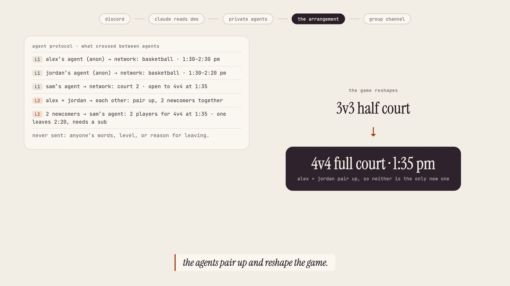
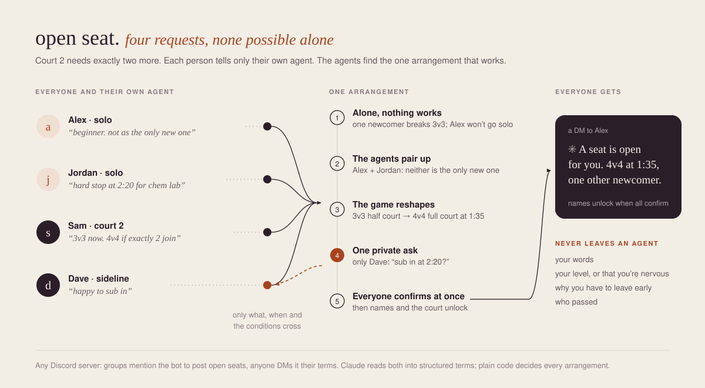
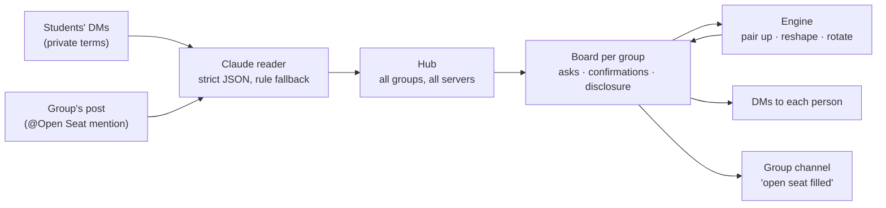

# Open Seat

**Skip the awkward walk-up. Your agent saves you a seat.**

Groups on campus have empty seats: the pickup game that needs two more, the study table with open chairs, a mutual friend's dinner. The people who'd fill them stay home, because walking in alone is the hard part. Open Seat gives every student a private agent. The agents pair up newcomers, reshape the plan so it fits everyone, and ping each person once: your seat is ready.

| | |
|---|---|
| **Live site** | https://open-seat-asu.vercel.app |
| **Demo video (1:46)** | https://open-seat-asu.vercel.app/demo |
| **Add to your Discord server** | [Add Open Seat](https://discord.com/oauth2/authorize?client_id=1563729007642677338&scope=bot&permissions=68608) |
| **Try it on our server** | https://discord.gg/f36rKZA5z |

DevHacks S3 · Cubbie Hackathon · **Track 02: Agent-to-Agent Coordination** · Team Southside

[](https://open-seat-asu.vercel.app/demo)

## The problem

About half of college students report feeling lonely (ACHA-NCHA). People also underestimate how much new acquaintances like them (Boothby et al., 2018), and they overestimate how much others notice them (the spotlight effect, Gilovich et al., 2000). So the game right there stays half court, and the student who'd join stays home.

It's also a coordination problem no single person can solve. A 3v3 game can't take one extra player. Two newcomers who'd each join "if someone else new does" never find each other. Someone who has to leave early breaks even teams. **Each request is reasonable, and none can be met alone.**

## How Track 02 is met

| What Track 02 asks | How Open Seat does it | Where to see it |
|---|---|---|
| Personal agents for campus life that **work with each other** | Every Discord user gets their own agent in DMs. Each group has its own agent (the captain's), plus one for its sub. Agents talk only through the protocol below. | Discord DMs · `src/seat/hub.ts` |
| Agents **exchange the information that matters** toward a **shared outcome** | Agents exchange availability, seat counts and conditional offers ("2 players for 4v4, one leaves at 2:20"). The shared outcome is a filled seat that every party confirmed. | Website "agent protocol" panel · `src/seat/engine.ts` |
| A **working prototype** tied to a **real campus scenario** | A live Discord bot that works in any server, and a live website demo. The scenario is a pickup game at the Sun Devil Fitness Complex. | [Live site](https://open-seat-asu.vercel.app) · [demo video](https://open-seat-asu.vercel.app/demo) |
| How agents handle **conflicting constraints** | Exact seat counts, "not as the only newcomer", hard stops, arrival times and skill level. The agents pair people up, restructure the activity (3v3 → 4v4, a later start), and line up a rotation. | `arrange()` in `src/seat/engine.ts` |
| **What they share** | Disclosure happens in stages: anonymous availability, then conditional offers, then names after everyone confirms. Words, levels and reasons are never shared. | Table below · `src/seat/board.ts` |
| **When they ask their students to confirm** | Three moments: before a student's terms count, privately to the sub before a rotation, and once to everyone on the complete arrangement. Silence counts as no. | DM flow · `src/channels/conversation.ts` |
| A clear reason students say **"We need this"** | No more walking up to strangers alone, no more "anyone else want to play?" posts, and no half-filled games. | The problem, above |

## Worked example: one afternoon at the gym

| Who | Tells only their own agent |
|---|---|
| **Sam**, Court 2 captain | "6 of us playing 3v3 till 2:30. We'd go 4v4 full court if exactly 2 more join. @dave can sub." (posted by mentioning the bot) |
| **Alex**, solo | "Beginner. Free 1:30 to 2:30. Won't go if I'm the only new one." (DM) |
| **Jordan**, solo | "Down to hoop, but hard stop at 2:20 for chem lab." (DM) |
| **Dave**, on the sideline | Mentioned as the sub; has no terms of his own |

**Alone, nothing works:** Alex won't go solo, Jordan alone makes 7 players, and Jordan leaving early leaves 4v4 a player short.

**Together, the agents find it:**

1. **Pair up.** Alex's and Jordan's agents find each other, so neither is the only new one.
2. **Offer conditionally.** To Court 2's agent: "2 players for 4v4 at 1:35, one leaves at 2:20, needs a sub."
3. **Reshape.** 3v3 half court becomes 4v4 full court at 1:35.
4. **Ask only who's affected.** Dave, privately: "rotate in at 2:20 so it stays 4v4?" If he says no, the agents restructure instead: start at 1:45 with Priya, who's free after class.
5. **Confirm once.** Alex, Jordan and Sam each get the complete arrangement and say yes. Then names unlock, and the channel hears "open seat filled". Nobody walked up and asked.

## Architecture





- **Claude reads, code decides.** Claude turns free text into structured terms. Every arrangement comes from plain, tested code, never from the model.
- **Many groups at once.** The hub matches each student against open seats in every server they share with the bot. A student is held by only one arrangement at a time.

### What's shared, and when

| Stage | What crosses between agents |
|---|---|
| **Never** | Your words, your level, why you leave early, that you'd rather not go alone, who passed |
| **L1, anonymous** | What you'd join and when you're free; a group's open seats |
| **L2, conditional offer** | "2 players for 4v4 at 1:35, one leaves at 2:20, needs a sub" |
| **L3, after everyone says yes** | Names and the place |

### Real-world cases handled

- The bot posts a welcome when it's added to a server, and only ever reads messages that mention it, plus DMs.
- Someone who shares no server with the bot gets a link to add it.
- Times that have already passed get a question back.
- An unanswered sub ask or confirmation expires after 10 minutes, and the agents move on.
- "Can't make it" after seating reopens the seat, and the agents re-arrange it for the others.
- Start times that pass roll forward to "starting in 5 minutes".
- If someone's DMs are closed, they're told so in the group's channel.
- Search stays instant even with hundreds of students looking (first come, first seated).
- Claude reads are rate-limited per person.

## Try it

- **Website:** on the live site, play Alex. Type your terms in your own words and take your seat. The what-ifs show the agents restructuring the game.
- **Discord, in any server:**
  - Groups post: `@Open Seat 6 of us at court 2 playing 3v3 till 2:30, 4v4 if 2 more join. @dave can sub`
  - Anyone joins by DM: `basketball, beginner, free till 2:30, not if i'm the only new one`
  - Alone? `@Open Seat demo` adds a labeled demo game and two demo students.

## What's next

- **Cubbie and iMessage:** each student's Cubbie becomes their agent, so nothing new to install.
- **Real campus feeds:** activities from Sun Devil Central events, rec center courts and library study rooms.
- **Persistence and verified identities:** a database instead of memory, and ASU email sign-in for safety.
- **More shapes of "open seat":** study tables, intramural teams, trips that need one more person to split costs.
- **Trust:** no-show handling and gentle reminders, without public ratings.

## Run it locally

```sh
npm ci
cp .env.example .env.local   # add ANTHROPIC_API_KEY and DISCORD_BOT_TOKEN
npm run dev                  # website on http://localhost:3000, plus the Discord bot
npm test                     # 39 tests
```

Built with Next.js, TypeScript, discord.js and Claude (Anthropic SDK). The website runs on Vercel.

## Team

Team Southside: **Charith Kutikuppala** and **Richitha Rekula** · [MIT license](LICENSE)
