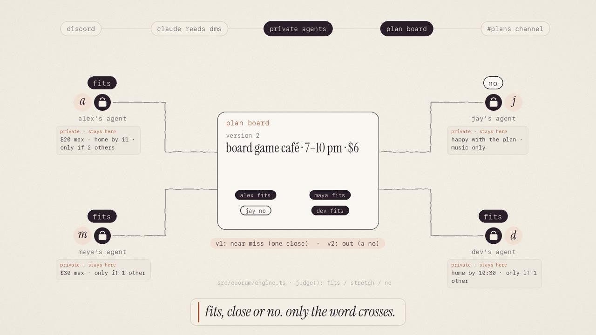
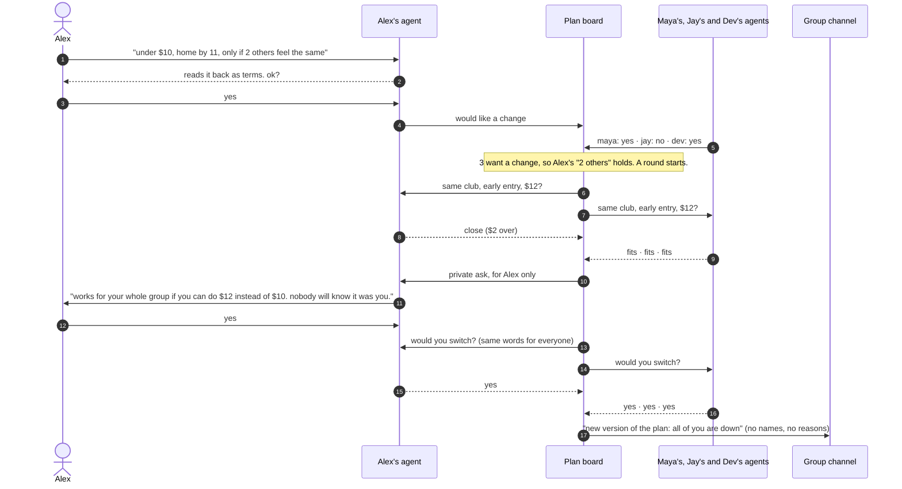

# down?

**The version of the plan everyone's actually down for.**

down? is a group-planning assistant where every person has their own private agent. Friends tell their agents how they really feel about the group's plan: what they can spend, when they need to be home, what they'd rather skip. The agents test versions of the plan against everyone's private terms, privately ask anyone who would need to stretch a little, and announce the version everyone agreed to without revealing who asked for the change.

Built for the Cubbie Hackathon at DevHacks S3, Track 02 (agent-to-agent coordination), by Team Southside.

**[Live site](https://down-kohl.vercel.app) · [Demo video](https://down-kohl.vercel.app/site/media/down-simulation.mp4) · [Discord demo server](https://discord.gg/f36rKZA5z)**

## Demo

[](https://down-kohl.vercel.app/site/media/down-simulation.mp4)

**[Watch the demo (1:43)](https://down-kohl.vercel.app/site/media/down-simulation.mp4)**

A $55 concert is planned in Discord. Four friends message their own agents, each agent turns its student's message into private terms, and the agents answer the plan board with one word per version. The one friend who is close gets a private ask, everyone receives the same question, and the group channel hears the result with no names. The video also shows what happens when that friend declines. Every value on screen comes from running the scenario through the engine in this repository.

## The problem

Group plans get made in the group chat, and the first idea tends to stick. People agree to plans they can't afford or don't want because each person assumes they're the only one (pluralistic ignorance; Prentice & Miller, 1993), and groups end up doing something nobody wanted (the Abilene paradox; Harvey, 1974). Money is often the unspoken reason: 44% of young adults say they've skipped a social event because of cost (Ally Bank, 2025). People also overestimate how much friends mind when they decline (Givi & Kirk, 2024).

down? lets a group find the plan it actually wants without anyone having to speak up first.

## How it works


1. **Each student talks to their own agent.** In a Discord DM, a student writes something like "$40 + an uber is a lot. under $10, home by 11, only if 2 others feel the same." The agent reads it into terms (whether they'd like a change, a budget, a curfew, kinds of plan they rule out, and a threshold), reads them back, and nothing counts until the student confirms.
2. **The agents test versions of the plan.** A round starts only when at least two people want a change and all of their thresholds hold, so a change can never be traced to one person. For each version, every agent answers with one word: *fits*, *close* (a small stretch would work) or *no*.
3. **Private asks.** If a version is close for someone, only that person is asked: "works for your whole group if you can do $12 instead of $10. ok? nobody will know it was you." Declining keeps the limit firm, and the agents move to the next version.
4. **Private confirmation.** Everyone in the version receives the same question, so the person who's happy with the original plan hears exactly what the person who can't afford it hears. A pass sends the agents to the next version.
5. **The group hears the result.** The group channel gets the new version with no names, counts or reasons. If no version fits everyone, the agents offer the one that fits the most people who wanted a change, and the original plan still stands for everyone else.

### Example round



If Alex declines the ask, the limit stays firm and the agents try the next version: most of the group moves to the open mic, and the club night still stands for Jay.

## Track 02 fit

| Requirement | How down? meets it |
|---|---|
| Personal agents for different students | Each person DMs the bot and talks only to their own agent |
| Conflicting constraints | Budgets, curfews, kinds of plan ruled out, "only if N others" thresholds, and friends who are happy with the original plan |
| What agents share | Whether their student would like a change, and one word per version (fits / close / no). Never messages, limits or thresholds |
| When agents ask their students | Before terms count, before stretching a limit (only the person affected), and before switching (everyone in the version) |
| Shared outcome | The version everyone confirmed, posted to the group channel |

## Where the plan comes from

Groups already plan in Discord, so the bot reads the server's scheduled events. The event with `#plan` in its description (or the soonest event) is the group's plan, and other events with a price in the description ("$12", "free") are the versions the agents may try. Without events, the bot uses a built-in demo plan.

## Getting started

Requires Node.js 22 or later.

```sh
npm ci
cp .env.example .env.local
npm run dev
```

| Variable | Purpose |
|---|---|
| `DISCORD_BOT_TOKEN` | Runs the Discord bot |
| `DISCORD_GROUP_CHANNEL_ID` | Optional. Channel for announcements; defaults to `#plans`, then `#general` |
| `ANTHROPIC_API_KEY` | Optional. Reads messages with a language model; without it, a rule-based reader handles budgets, curfews and thresholds |
| `ANTHROPIC_MODEL` | Optional. Model used when the key is set |

- **Website:** open http://localhost:3000 and use the "okay, are you not down?" section to play Alex against three demo friends. Served by the app, the site uses the same engine as the bot. Hosted as static files (`public/site`), the same rules run in the browser (`public/site/prototype.js`), and a test keeps both in sync.
- **Discord:** invite the bot to a server, DM it, and pick a seat (alex, maya, jay or dev). Unclaimed seats are played by demo friends, so it works with one to four people. DM `reset demo` to start a fresh round. The bot needs only the Direct Messages, Guilds and Guild Scheduled Events intents.

## Testing

```sh
npm test
npm run typecheck
```

The suite has 59 tests covering how agents judge versions, stretches and thresholds; private asks and passes; what each student can and can't see; the DM conversation; message reading (model and rule-based); reading plans from Discord events; and parity between the in-browser rules and the engine across more than 1,400 combinations of terms and answers.

## Project structure

| Path | Contents |
|---|---|
| `src/quorum/engine.ts` | How each agent judges a version, stretches, thresholds, and choosing a version |
| `src/quorum/board.ts` | One plan's round: private asks, confirmations, passes, the announcement, and each student's view |
| `src/agents/language.ts` | Reads a student's message into terms (strict JSON schema, with a rule-based fallback) |
| `src/channels/` | The Discord DM conversation, the bot bridge, and reading plans from Discord events |
| `src/server/plan-runtime.ts`, `app/api/try` | The live plan for the bot, and a fresh board per website visitor |
| `public/site/` | The website |

## Tech stack

Next.js 16 · TypeScript · discord.js · Anthropic SDK (optional message reading) · Zod · Vitest · Vercel

## Privacy model

This is a prototype's privacy model, not a security guarantee. All agents run on one server, which holds each student's terms; the protocol limits what crosses between agents to one-word answers and what each student sees to their own view. A round never starts with fewer than two people wanting a change, and everyone receives the same question, but in a small group people can still guess. Names, counts and reasons are never posted. All people, events and prices in the demo are fictional, and nothing is booked or paid.

## Team

Team Southside: **Charith Kutikuppala** and **Richitha Rekula**.

## License

[MIT](LICENSE)
